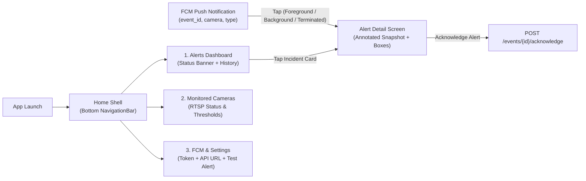

# PyroGuard Mobile — UI Wireframes & Navigation Flow

**Module Owner:** Melih Aşık (Mobile Application & Integration)  
**Target Platform:** Flutter (Android & iOS, Material 3)

---

## 1. End-to-End Alert & Navigation Flow



---

## 2. Screen Wireframes

### Screen 1: Alerts Dashboard (`lib/screens/alerts_screen.dart`)

```text
+------------------------------------------+
| 🔥 PyroGuard Alerts                      |
+------------------------------------------+
| +--------------------------------------+ |
| | 🔥 2 Unacknowledged Alert(s)         | |
| | [FCM Active] [API Connected] [3 Evt] | |
| +--------------------------------------+ |
|                                          |
| Event History                            |
| [All*] [Fire & Smoke] [Flame] [Smoke]    |
|                                          |
| +--------------------------------------+ |
| | (⚠) FLAME & SMOKE                 ●  | |
| |     CAM-01 · Main Warehouse        > | |
| |     20 Nov · 11:45 · 91% · 5-frame   | |
| +--------------------------------------+ |
| +--------------------------------------+ |
| | (☁) SMOKE DETECTED                ●  | |
| |     CAM-02 · Electrical Room       > | |
| |     20 Nov · 11:12 · 78% · 4-frame   | |
| +--------------------------------------+ |
| +--------------------------------------+ |
| | (🔥) FLAME DETECTED               ✓  | |
| |     CAM-01 · Main Warehouse        > | |
| |     20 Nov · 08:37 · 86% · 4-frame   | |
| +--------------------------------------+ |
+------------------------------------------+
|  [🔔 Alerts]   [📹 Cameras]  [⚙ Settings] |
+------------------------------------------+
```

### Screen 2: Incident Detail & Bounding-Box Inspector (`lib/screens/alert_detail_screen.dart`)

```text
+------------------------------------------+
| ← Incident Details                       |
+------------------------------------------+
| +--------------------------------------+ |
| |  +------------------+                | |
| |  | SMOKE 84%        |                | |
| |  |    +-----------+ |   (16:9 RTSP   | |
| |  +----| FLAME 91% |-+    Snapshot)   | |
| |       +-----------+                  | |
| | [snapshot_path / overlay preview]    | |
| +--------------------------------------+ |
|                                          |
| CAM-01 · Main Warehouse                  |
| Building A - Ground Floor                |
| ---------------------------------------- |
| Event ID        evt-1001                 |
| Event Type      BOTH                     |
| Max Confidence  91.0%                    |
| Temporal Streak 5 consecutive frames     |
| Detected At     2026-11-20 11:45:10      |
| Status          Active / Pending         |
|                                          |
| Detected Bounding Boxes (2)              |
|  • FLAME · 91.0%  (0.22,0.42)→(0.52,0.80)|
|  • SMOKE · 84.0%  (0.18,0.14)→(0.64,0.48)|
|                                          |
| [        ✓  Acknowledge Alert          ] |
+------------------------------------------+
```

### Screen 3: Monitored Cameras (`lib/screens/cameras_screen.dart`)

```text
+------------------------------------------+
| 🔥 Monitored Cameras                     |
+------------------------------------------+
| +--------------------------------------+ |
| | (📹) CAM-01 · Main Warehouse [ONLINE]| |
| |      Building A - Ground Floor       | |
| |      Threshold: 45% · rtsp://...     | |
| +--------------------------------------+ |
| +--------------------------------------+ |
| | (📹) CAM-02 · Electrical Room[ONLINE]| |
| |      Building B - Basement           | |
| |      Threshold: 50% · rtsp://...     | |
| +--------------------------------------+ |
| +--------------------------------------+ |
| | (🚫) CAM-03 · North Courtyard[PAUSED]| |
| |      Outdoor - North Gate            | |
| |      Threshold: 45% · rtsp://...     | |
| +--------------------------------------+ |
+------------------------------------------+
|  [🔔 Alerts]   [📹 Cameras]  [⚙ Settings] |
+------------------------------------------+
```

### Screen 4: FCM Status & Settings (`lib/screens/settings_screen.dart`)

```text
+------------------------------------------+
| 🔥 FCM & Settings                        |
+------------------------------------------+
| +--------------------------------------+ |
| | 🔔 Firebase Cloud Messaging (FCM)    | |
| | Status: ready / configMissing        | |
| | Token:  eX9k2... (Copy 📋)           | |
| | [ ⚡ Trigger Local Test Alert ]      | |
| +--------------------------------------+ |
| +--------------------------------------+ |
| | Backend FastAPI Connection           | |
| | API Base URL: [http://10.0.2.2:8000] | |
| | [ ↻ Test /health ]  Connected        | |
| +--------------------------------------+ |
+------------------------------------------+
|  [🔔 Alerts]   [📹 Cameras]  [⚙ Settings] |
+------------------------------------------+
```
